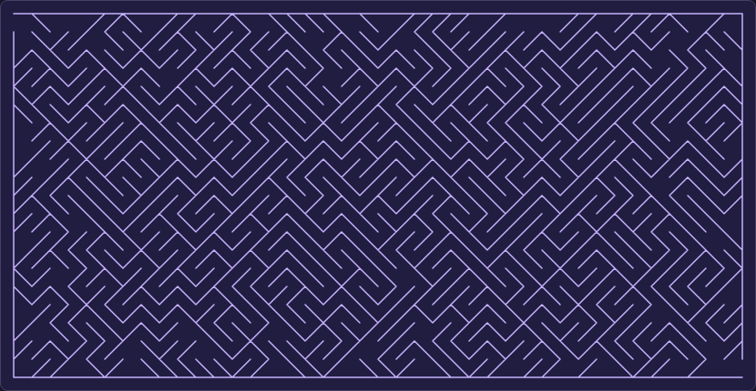

# mazepet

[Play mazepet in your browser](https://carlkcarlk.github.io/mazepet/).

[](https://carlkcarlk.github.io/mazepet/)

Inspired by the Commodore 64's [10 PRINT](https://10print.org/), which draws a maze-like picture from random PETSCII diagonals:

```basic
10 PRINT CHR$(205.5+RND(1)); : GOTO 10
```

mazepet repairs that random picture into a solvable maze while trying to preserve its original diagonals.

## Algorithm sketch

1. **Draw the picture.** Fill each tile randomly with `/` or `\`, splitting it into two triangular rooms.
2. **Connect the passages.** Visit diagonals in random order. Erase a diagonal when its two rooms belong to disconnected passage regions, until every room is reachable.
3. **Attach wall islands.** Search through empty tiles for chains of diagonals that connect detached walls to the border-connected wall network. Favor larger islands when attachment paths compete for a tile.
4. **Remove unattached islands.** Erase any wall sections that could not be connected to the border.
5. **Narrow the halls.** Repeatedly try filling empty tiles with their original diagonal, then its opposite. Keep a diagonal only if it extends the border-connected walls to a new corner without cutting off passages.

Union-find tracks passage regions and, separately, connected walls. Island attachment uses breadth-first search. All interior walls remain whole diagonals; no horizontal, vertical, or half-tile walls are added. The repair favors fewer changed tiles but does not guarantee the minimum possible number of edits.

The solver uses breadth-first search through the triangular rooms. Its highlighted route follows passage openings, with small wall-safe shortcuts to remove unnecessary jogs.

## Run locally

Serve this directory with `python3 -m http.server 8000 --bind 127.0.0.1` and open <http://localhost:8000>. Computers start with a 25×20 maze; phones start with dimensions fitted to their screen. Set the width and height and click **Generate** for a new maze. Playing uses plain JavaScript with no runtime dependencies or external requests.

Use **Show original** to play the exact random layout before repairs, then **Fix** to return. Each view keeps its own route and revealed solution. The original layout may have no route to the exit; **Solve** reports when the exit is unreachable. **Start over** resets only the current view. Generating a new maze resets both views and keeps the current mode.

Tap or click a little ahead of the line, starting near the upper-left entrance, or drag with a mouse or finger. You don't need to grab the dot. Short jumps follow a single clear passage, including around bends, for up to about sixteen tiles of travel. Distant taps, taps on walls, and jumps with two possible nearby routes leave the line in place. At forks, tap clearly into your chosen branch. Wrong turns are allowed—the interaction never consults the solution.

Tap or drag backward along your route to erase steps. Lift your finger or release the mouse to pause, then tap ahead again to resume. Reach the lower-right exit to see a **Maze complete!** banner and green highlight, with a brief animation that respects reduced-motion preferences. Use **Start over** to clear your route on the same maze, or **Solve** to reveal the answer. Revealing the answer does not count as completing the maze. Pinch with two fingers to zoom, or scroll outside the maze to navigate large mazes; dragging inside the maze with one finger traces your route.

For a Unicode terminal version and the automated checks, use Node.js:

```sh
node maze.js 30 15
npm ci
npm run check
npm test
npx playwright install chromium
npm run test:browser
```

The browser controller and seed/URL module use JSDoc types checked by TypeScript. JavaScript is served directly; there is no application compilation step.

## Share the same maze

The URL records the actual generated width, height, mode (`fixed` or `petscii`), and eight-digit hexadecimal seed. For example:

```text
https://carlkcarlk.github.io/mazepet/v0.1.0/?w=25&h=20&mode=petscii&seed=8ac31f02
```

**Generate** chooses a fresh seed, keeps the current mode, and adds a browser history entry. Back and Forward restore previous layouts and modes, starting their routes over. Switching modes updates the current URL while preserving each mode's progress in memory. Editing dimension fields does not change the link until you generate. A shared link starts a fresh attempt and does not include progress or a revealed solution.

Copy the address-bar URL to share the current maze. URL dimensions override screen fitting, so opening a shared maze on a phone preserves the exact maze. Invalid values fall back to defaults; dimensions are limited to 200 each and 10,000 cells total.

The PRNG is Mulberry32 with a 32-bit seed, used for every random choice during generation. Seeded output is covered by a compatibility snapshot test. Changing seeded output requires a major version bump.

## Policy on AI-assisted development and contributions

The use of AI tools is permitted for development and contributions to this repository. AI may be used as a productivity aid for drafting, exploration, and refactoring.

All code and documentation contributed to this repository must be reviewed, edited, and validated by a human contributor. AI tools are not a substitute for design judgment, testing, or responsibility for correctness.

## Deployment

The [GitHub Pages workflow](.github/workflows/pages.yml) checks types, runs unit and browser tests, then publishes every stable release from Git tags. It runs on pushes to `main`, version tags, and manual dispatch. A push to `main` without a release tag does not release new application code.

`package.json` is the authoritative three-part version. Tag `v0.1.0` must refer to a commit with package version `0.1.0`. Each release provides its static files through `site-files.json`; the packager reads them directly from the tag without running historical build scripts. Never move or delete a published release tag.

- `/mazepet/` redirects to the latest stable release.
- `/mazepet/v0.1.0/` serves that exact release permanently.

Redirects preserve query parameters and fragments, so the address bar and shared links pin the full version. `releases.json` lists release versions and source commits. Prerelease tags are excluded.

For a local versioned preview, run `npm run build -- --preview` followed by `npm run preview`. Production `npm run build` requires at least one stable tag and packages only tagged files. Both commands replace `_site/`.

CI uses the Chrome browser already installed on the Ubuntu 24.04 runner.

To release after validation, update the package version and lockfile together, commit, create the matching Git tag, and push the commit and tag. Keep all old tags: each deployment rebuilds their archived directories so old links continue to work.

## License

Licensed under either:

- [MIT license](LICENSE-MIT)
- [Apache License, Version 2.0](LICENSE-APACHE)

at your option.
